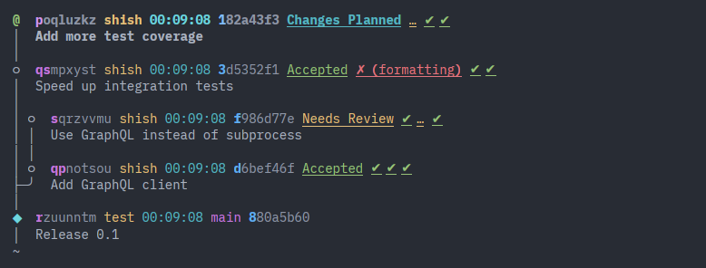
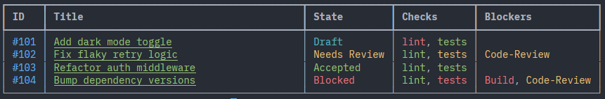

# JJ with Code Review Integration

A hopefully-short-lived JJ fork, to be used as a proof-of-concept / MVP / discussion-point - my long-term wish is to archive this repository because the features exist upstream and the fork is no longer needed :)

# Features

Currently supporting GitHub, Gerrit, Phabricator, Forgejo, and GitLab.

For each forge, there is a suite of `jj <forge> <command>` commands available (`jj github upload`, `jj forgejo abandon`, etc). Built on top of all those, there is a `jj cr <command>` abstraction layer which will automatically select the appropriate backend, allowing developers to memorise one set of commands and use the same muscle memory for all forge types. 

* `jj cr upload` - create or update a code review for each commit in the current branch (1 change : 1 review)
* `jj cr rebase` - rebase the current branch on top of its merge target (eg if the PR is based on `main`, rebase on top of `main`; if the PR is based on another PR, rebase on top of that other PR)
* `jj cr list` - list the status of my open PRs/CRs/Diffs
* `jj cr log` - show `jj log` output annotated with review status
* `jj cr download <pr/cr/diff>` - download a specific PR/CR/Diff from the forge

# Stability Notice

On the one hand, this is strictly an experimental repo, I reserve the right to make breaking changes at any time if I figure out a better way to implement something. On the other, I'm using this myself for my day-to-day work, so I don't want it to be broken :)

Also for as long as I'm the only person looking at this repo, I'm making liberal use of `jj split` and `jj absorb` to rewrite history so that each layer of the code gets its own commit, as well as rebasing the `jj-cr` branch on top of upstream's `main` branch. Again, if anybody has any interest in collaborating, let me know and I'll switch to a more normal workflow where the foundations aren't constantly-shifting :)

# Why is this useful?

Because I'm regularly using github, gerrit, and phabricator, and I don't like any of their standard `git` workflows (and then I go ahead and use `jj`, which has *much* better client-side UX, but the forge integrations are even less-well-supported...)

# Workflow

* `jj cr rebase --all-branches` - start the day by pulling remote changes and rebasing all my local branches on top of them
* `jj cr list` / `jj cr log` - check for any reviews which need attention

## If I want to work on a new feature

* `jj new 'trunk()'` - create a new branch off of trunk (ie, `main` or `master`)
* `vim ...` - make some changes
* `jj commit` - commit the first unit of work
* `vim ...` - make more changes
* `jj commit` - commit the next unit of work
* `jj cr upload` - upload the two commits for review

## If any of my code needs to be changed based on feedback

* `jj edit <change id>` - switch to the change that needs to be fixed
* `vim ...` - make the changes
* `jj cr upload -m 'fixed the bugs'` - upload an updated version of the commit for review, with a comment listing what changed since last time

## If I want to test somebody else's code

* `jj cr download <pr/cr/diff>` - download a specific PR/CR/Diff from the forge

# Backend Notes

* Backend will be automatically detected based on the git remote URL (eg github.com = use the github backend, codeberg.org = use the forgejo backend)
* If that doesn't work, you can set the backend explicitly with `jj config set --repo cr.forge <backend>`
* You can also skip the forge abstraction layer, replacing eg the lowest-common-denominator `jj cr upload` with the more flexible gerrit-specific `jj gerrit upload`

# Technical Notes

Design decisions relevant to specific backends will be comments in the code for that backend

## Common-ish interface for forge backends

* eg `jj gerrit abandon` and `jj phabricator abandon` and `jj github abandon` - even though github calls it "closing" a PR and not "abandoning", I personally think it's nicer for jj to be internally-consistent rather than consistent with each forge (who all use very different terminology, sometimes mutually-exclusive terminology - eg in phabricator "submit" is synonymous with "upload for review"; in gerrit "submit" is synonymous with "merge into trunk and push")

## Lowest-common denominator front layer

* `jj cr X` should work for every feasible forge, and work as consistently as possible across forges
  * In most cases so far, the generic eg `jj cr abandon <CR ID>` and the backend eg `jj gerrit abandon <CR ID>` take literally the same `CrAbandonArgs` struct
  * It's possible for backends to have backend-specific options, eg my `jj cr upload` has very minimal features, but under the hood it translates into a call to `jj gerrit upload`, and all the power and features of `jj gerrit upload` are still available

## Code review status fetching for `jj cr log`

* resolve the `--revision` flag into a list of Commit IDs which are due to be displayed
* for each Commit ID, try to determine a Code Review ID
  * for gerrit, this is the `Change-Id:` trailer, falling back to the change-id which jj generates during uploads
  * for phabricator, this is the `Diffusion Revision:` "trailer"
  * for github, this is the branch name
* for each Code Review ID, fetch the code review status (ideally in a single batch call if the API supports it)
* create a map of Commit ID -> Code Review Status
* call `jj log` with this status map as an extra parameter
* the custom template function `Commit.review()` will check the status map, and return either `None` or `Some(CodeReview)`
  * CodeReview has various fields for overall status, CI/CD checks, unresolved comments, etc
* the standard templating system renders the CodeReview however the user prefers

## Testing

* For any open-source forge, there is an instance configured in [compose.yml](compose.yml)
* Fully-automated setup
  * Pre-create an admin user with known password and API keys
  * Do any setup to get to the point where repos can be created via API
  * Should have no persistent state - restarting the container should reset back to "basic install with admin user"
* Each forge has a `TestRepo` struct, eg `GerritTestRepo` -- `GerritTestRepo::new()` will use the pre-populated admin credentials and the API to create a fresh test repository; tests can then clone / push / pull / etc; then when this struct is dropped, the test repository is deleted.

# Status Matrix

GitHub, Gerrit, and Phabricator I'm personally using on a daily basis. The code contains some hacks and duct-tape to make it work, but it works well enough for my use-cases.

Forgejo and GitLab backends contain a high percentage of vibe-coded AI slop, I only include them for the sake of experimenting with those forges' respective APIs, to check if there's anything in those APIs which is fundamentally incompatible with the architecture I'm using.

<table>
    <tr>
        <th>Backend</th>
        <th>Upload</th>
        <th>Download</th>
        <th>List</th>
        <th>Log</th>
        <th>Rebase</th>
    </tr>
    <tr>
        <td>Gerrit</td>
        <td>✅</td>
        <td>✅</td>
        <td>✅</td>
        <td>✅</td>
        <td>✅</td>
    </tr>
    <tr>
        <td>GitHub</td>
        <td>GitHub's stacking API is... weird</td>
        <td>✅</td>
        <td>✅</td>
        <td>✅</td>
        <td>✅</td>
    </tr>
    <tr>
        <td>Phabricator</td>
        <td>Makes use of `arc` CLI, not fully native</td>
        <td>Makes use of `arc` CLI, not fully native</td>
        <td>✅</td>
        <td>✅</td>
        <td>Only supports a single target branch</td>
    </tr>
    <tr>
        <td>Forgejo</td>
        <td>No stacking API</td>
        <td>✅</td>
        <td>✅</td>
        <td>✅</td>
        <td>?</td>
    </tr>
    <tr>
        <td>GitLab</td>
        <td>?</td>
        <td>?</td>
        <td>?</td>
        <td>?</td>
        <td>?</td>
    </tr>
</table>

# Related Discussions / Code

* https://github.com/jj-vcs/jj/issues/485 - Add support for pushing stacked reviews to GitHub, GitLab, etc
  * https://github.com/jj-vcs/jj/issues/4387 - Gerrit Support
    * https://github.com/jj-vcs/jj/issues/8490 - `gerrit abandon`
    * https://github.com/jj-vcs/jj/issues/8846 - `gerrit url`
    * https://github.com/jj-vcs/jj/issues/10116 - `gerrit download`
    * https://github.com/jj-vcs/jj/pull/9284 - `gerrit comments`
  * https://github.com/jj-vcs/jj/issues/4555 - GitHub Support
    * https://github.com/jj-vcs/jj/issues/5442 - FR: Enhance log to include Github PR Numbers and state
  * https://github.com/jj-vcs/jj/issues/9400 - Phabricator Support

# Original README

Original README for JJ without Code Review Integration is at [ORIGINAL_README.md](ORIGINAL_README.md)
